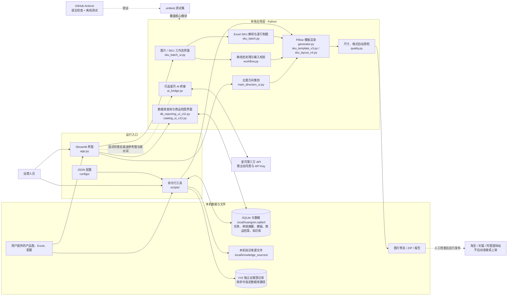

# 架构概览

本文基于当前仓库的运行入口、核心模块和数据流整理。项目是本地运行的工业五金电商图片排版与商品资料管理工具；它不连接电商平台后台，也不会自动发布商品。

## 主要数据流

- **标准制图（本地离线）**：界面或 `scripts/build_images.py` 读取用户图片与参数，`workflow.py` / `sku_batch.py` 校验输入并调用 `generator.py` 或 SKU 模板。`quality.py` 检查可自动验证的输出属性，结果以预览、ZIP 和报告提供；产品真实性、结构和平台合规仍由人员审核。
- **资料与商品管理（本机）**：`database_v9.py` 管理 SQLite 任务、审核摘要和布局模板；`catalog_v12.py` 扩展商品 / SKU 档案；V13 知识模块对本地资料建立可检索索引与证据定位。数据库不保存产品原图或 API 密钥。V15 `evidence_registry_v15.py` 的证据登记与正式 SKU 档案隔离。
- **可选 AI 制图（外部服务）**：只有用户在界面显式同意并提供密钥后，`ai_bridge.py` 才将所选参考图与提示词发送给星河服务。该路径不同于离线 Pillow 排版。
- **验证**：`tests/` 中的 unittest 覆盖图片生成、SKU、数据库、证据登记与相关安全约束；`.github/workflows/ci.yml` 在 Python 3.10 和 3.12 上执行语法检查及离线测试。

## 重要边界

- 传统排版只对原图等比例缩放和布局，不重绘产品结构；未知参数、认证或性能不得推断。
- 图像生成与资料库均为本机流程；向第三方发送图片仅限可选 AI 功能并需明确同意。
- 发布前须人工检查产品结构、尺寸、文字、合规和视觉质量。平台节点表示人工发布目标，不代表项目集成了平台 API。
