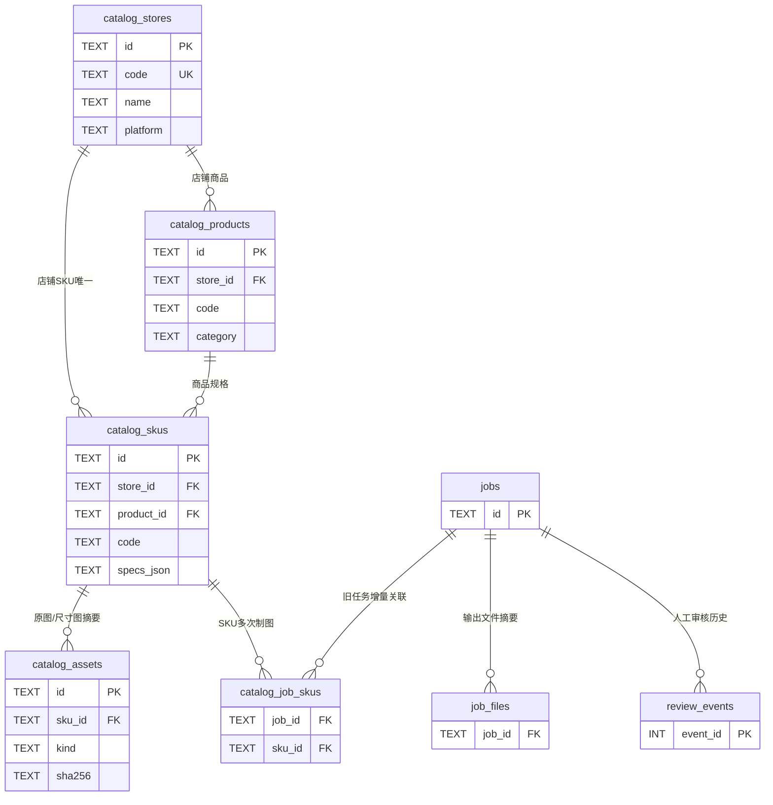

# V12 工业五金数据库：多店铺 · 商品 · SKU · 素材 · 制图任务

> 这是在现有 V10 / V11 SQLite 业务元数据数据库上的**增量扩展**，不是另建一个会丢失历史任务的数据库。商品原图、尺寸图及 API 密钥始终不写入数据库，也不要推送到公开 GitHub 仓库。

## 1. 为什么需要这套关系

早期 `jobs/job_files/review_events/templates/imported_files` 只知道“生成了什么文件、是否审核”，无法确定这个结果属于哪家店、哪一个商品或哪个 SKU；单纯使用文件名反推关联会造成串 SKU 风险。

V12 提供店铺、商品、SKU 档案作为可信索引；旧任务**不自动猜测关联**，运营人员核实后才能执行关联。一个商品可有多个 SKU，一个 SKU 可关联多个制图任务、多个素材摘要。



## 2. 数据字典

| 表 | 核心字段 | 防错约束 |
| --- | --- | --- |
| `catalog_meta` | `schema_version` | 商品档案自己的版本号为 1；与旧库 `PRAGMA user_version=2` 独立 |
| `catalog_stores` | `id`、`code`、`name`、`platform`、`active` | 店铺编码忽略大小写唯一；平台只接受淘宝、天猫、阿里国际站、其他 |
| `catalog_products` | `id`、`store_id`、`code`、`name`、`category` | 一个店铺中商品编码唯一，外键关联店铺 |
| `catalog_skus` | `id`、`store_id`、`product_id`、`code`、`model`、`specs_json` | 同店铺 SKU 编码唯一；复合外键保证 SKU 不会关联其他店铺商品 |
| `catalog_assets` | `id`、`sku_id`、`kind`、`filename`、`sha256`、`width/height` | 只保存文件元数据，同 SKU + 类型 + SHA256 去重；不存图片字节 |
| `catalog_job_skus` | `job_id`、`sku_id`、`linked_utc` | 通过外键关联已有 `jobs` 与 `catalog_skus`；重复关联幂等 |
| `catalog_events` | `event_id`、`entity_type/id`、`action`、`details_json` | 记录新增/关联事件，普通 SQL 更新和删除受触发器禁止 |

旧库 `jobs`、`job_files`、`review_events`、`templates`、`imported_files` 五表**完全保留**，不会因为 V12 初始化而清空或改名。

### SKU 参数格式（只记录显式确认数据）

`specs_json` 含 `material` 材质、`surface` 表面处理、`hole_spacing_mm` 孔距、`total_length_mm` 总长、`note` 备注，所有值为文本。空字段代表**未确认**，不自动推断。`孔距(mm)` / `总长(mm)` 仅支持已确认的纯数字毫米值。字段不够时，未来应通过显式迁移增加扭矩、门板厚度等字段，而不是把未经证实的数据写入。

## 3. 在旧数据库上安全安装

**先关闭 Streamlit 和正在写数据库的脚本，并备份原有 `.local/` 目录。** 旧数据库若有真实历史记录，建议先使用已有备份脚本生成一致性快照：

```bash
python scripts/db_admin.py check
python scripts/db_admin.py backup --output backups/before_catalog_v12.sqlite3
```

新用户可以先用 `python scripts/db_admin.py init` 初始化空的旧版基础数据库，再运行：

```bash
python scripts/catalog_admin.py init
python scripts/catalog_admin.py check
python scripts/catalog_admin.py template --output sku_catalog.csv
```

没有已存在的数据库时，也可直接执行 `catalog_admin.py init`（会创建旧版基础元数据表和新增商品档案表）。V12 采用事务创建新表，数据库异常或表结构冲突会拒绝继续，不会删除旧版任务。

## 4. 助理录入工作流程

1. 打开 `sku_catalog.csv`，每行填写一家店铺的一个 SKU。必须填店铺编码/名称/平台、商品编码/名称/类别、SKU 编码。
2. 可选填写真实产品型号、材质、表面处理、孔距、总长和备注；未核实的项目留空。
3. 保存为 UTF-8 CSV。**一个 SKU 对应一行**；同一商品的多 SKU 重复填写该商品编码。
4. 使用只读预演核对预计新增的店铺、商品、SKU 数量；正式导入前备份。
5. 正式导入采取整个 CSV 单事务；遇到一个不一致则**整批回滚**。重复导入相同资料只计为 unchanged；相同编码对应不同材质/参数时拒绝覆盖。

```bash
python scripts/catalog_admin.py import-csv --input sku_catalog.csv
# 确认预演无误后，执行：
python scripts/catalog_admin.py import-csv --input sku_catalog.csv --apply
python scripts/catalog_admin.py check
python scripts/catalog_admin.py list-skus --store SHOP-01
python scripts/catalog_admin.py list-skus --search MS705 --csv > sku_results.csv
```

也可以在 Streamlit 的 **「⑥ 商品 / SKU 档案」** 下载 CSV 模板、预演、确认写入及按店铺检索。

## 5. 制图、审核与素材如何关联

- `catalog_assets` 通过 SKU ID 登记照片文件名、真实 SHA256、像素尺寸、素材类型；**并不上传照片**。原图及审核通过的成品 ZIP 必须单独备份。
- 原系统 `jobs` 仍记录每批制图任务，`job_files` 存每张成品的 SHA256，`review_events` 存人工审核历史；V12 不更改这套审核语义。
- `catalog_job_skus` 将已核实归属的任务与 SKU 建立关系。历史 V6/V10 任务没有 SKU ID 时，不会根据文件名或“看起来相似”自动关联。
- 所有新建档案与手动关联在 `catalog_events` 追加操作轨迹，但这不是经过签名的不可篡改审计。

## 6. 安全和数据质量规则

- 使用 SQLite 外键、编码唯一约束、索引、事务、参数化查询；CSV 默认只预演，显式 `--apply` 才写入。
- CSV 最大 3MB / 500 行；不执行公式，不接受 `= + - @` 开头的字段；拒绝同 SKU 参数冲突、未知平台及负尺寸。
- 只读页面不创建或迁移数据库；读取历史任务和审核记录仍需原 V10 的完整性检测。
- 多店铺属于数据归类，不等于用户权限隔离：目前没有登录账号、角色权限和跨电脑同步。
- 数据库里的 SHA256 是检测文件变化的摘要，不替代人工核对孔位、材质、尺寸文字。
- `catalog_events` 为普通本机 SQLite 操作日志；具有文件系统高级权限的人仍可篡改数据库，不能当作强审计。

## 7. 备份、恢复和上线验收

- `catalog_admin.py check` 只读检查新表完整性、外键和业务参数格式；原 `db_admin.py check` 继续检查旧五张表及审核摘要。
- **SQLite 一致性备份**使用原 `db_admin.py backup`，会包含新增表，不要直接复制正在使用的 `.sqlite3` 主文件。
- 恢复使用原 `db_admin.py restore`（先停止应用）；恢复后执行两种 `check`，再核对 SKU 数量和至少一条关联记录。
- 测试用的示例商品编码仅供流程演练，不代表你的真实商品认证、检测或性能参数。

## 8. 目前不包含

此版不会迁移或覆盖旧任务，也不自动从 Excel 成交数据生成 SKU 档案；不会从图片识别参数；不会自动同步淘宝/天猫后台。竞争店铺价格快照、订单指标、团队权限、跨设备数据库与审批签名可作为后续独立业务子模块设计，不应在本地数据库未完成真实验收前直接上线。
