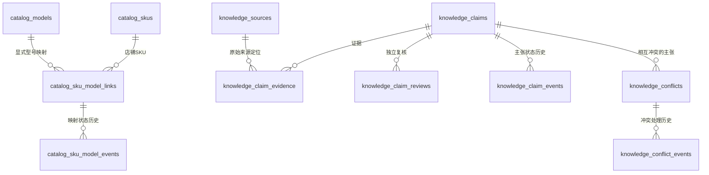

# V13 工业五金知识库：核心数据模型与证据闭环

## 目标与兼容性
V13 是 V10 任务数据库和 V12 商品/SKU 档案之上的增量层。不重建原库、不改动 `PRAGMA user_version`，也不更改 V12 `catalog_meta.schema_version=1`。V13 自己使用 `knowledge_meta.schema_version=1`。首次初始化以外，遇到未知版本、半残缺表或缺失保护触发器会拒绝自动修复。

## 数据关系


## 表说明
- `catalog_models`: 制造商级型号身份，与店铺商品和 SKU 分离。不会因 SKU 自由文本型号相同而自动建立关系。
- `catalog_sku_model_links` + `catalog_sku_model_events`: 先提议，再由有证据的审核人确认；每次决定追加事件，不覆盖旧决定。
- `knowledge_sources`: 原始文件元数据、SHA-256、大小、文档编号、修订标识、日期、存储引用和可选的被替代来源。文件字节不写进 SQLite。来源权威级别是录入时声明，不等于系统已认证来源。
- `knowledge_claims`: 一个参数一个主张，保留原始字面值、可选标准化 JSON、单位、主张类型和替代关系。
- `knowledge_claim_evidence`: 关联来源、PDF 页码、印刷页码、区域坐标、原文摘录、提取方法和置信说明。
- `knowledge_claim_reviews`: 追加式支持/反对/不确定复核，记录复核人角色与方法。
- `knowledge_claim_events`: 主张状态历史。进入 accepted 必须有支持性来源证据和第二人、制造商或独立检测机构的支持性复核；出现反对性复核/证据会阻止接受，已接受的主张遇到新反证会自动重新打开。
- `knowledge_conflicts` + `knowledge_conflict_events`: 记录同一对象、同一参数的冲突。解决冲突必须指定来源及处理说明；后续可以重新打开。
- 来源、主张、证据、审核和事件通过 SQLite 触发器禁止普通 UPDATE/DELETE。具有数据库文件写权限的人仍可能直接篡改 SQLite，因此这不是加密签名的防篡改审计。

## 状态与边界
- `proposed`: 已记录，但尚未获得完整证据/复核。
- `accepted`: 满足数据库门槛；不等于法律认证或产品全性能认证。
- `rejected`: 当前审核不接受该主张。
- `superseded`: 已有同一对象、同一属性的新主张替代。
- `reopened`: 重新审查，历史状态保留。
- PDF 页码从 1 开始；印刷页码另存，避免两者混淆。
- SHA-256 只证明注册时计算的字节指纹；推荐使用 `register-source-file` 从本地原件计算。不要把手工填写的哈希当作已核验。
- 任何型号/SKU 关联都必须显式建立；不根据文件名、相似图片或自由文本自动绑定。
- 未经实物测量的目录参数仍属于目录转录；未获独立复核的参数不能标记为已独立验证。

## 安装与检查
先备份 `.local/`，再确保已有 V12 商品档案：

```bash
python scripts/catalog_admin.py init
python scripts/knowledge_admin_v13.py init
python scripts/knowledge_admin_v13.py check
python scripts/knowledge_admin_v13.py summary
python scripts/knowledge_admin_v13.py add-model --code GL1-336 --category 阻尼转轴 --manufacturer "汇成五金"
python scripts/knowledge_admin_v13.py register-source-file --file "/path/to/catalog.pdf" --kind manufacturer_document --authority user_supplied --document-family "GL1产品目录"
```

`register-source-file` 计算文件指纹，只登记元数据，不复制源文件。请妥善保存源文件，并用 `--storage-ref` 填写项目约定的相对存储引用。权威级别应由相应凭证支持，不能因为选了某个值就视为系统验证。

## Python API 流程示例
```python
from ecom_images.knowledge_v13 import add_model, register_source_file
from ecom_images.knowledge_claims_v13 import create_claim, add_claim_evidence, add_claim_review, transition_claim

model_id = add_model(model_code="GL1-336", category="阻尼转轴", manufacturer_name="汇成五金")
source_id = register_source_file(file_path="资料/GL1-336图纸.pdf",
    source_kind="manufacturer_document", authority_level="user_supplied",
    document_family="GL1-336", revision_label="待确认")
claim_id = create_claim(subject_type="model", subject_id=model_id, attribute="扭矩单位",
    literal_value="N.m", claim_kind="catalog_transcription", created_by="运营")
add_claim_evidence(claim_id=claim_id, source_id=source_id, evidence_role="supports",
    extraction_method="manual", created_by="运营", pdf_page=37, printed_page="24",
    region={"bbox":[100,200,400,500]}, literal_excerpt="扭矩 N.m")
# 第二人实际复核后，才能添加支持性复核并将主张转为 accepted。
add_claim_review(claim_id=claim_id, verdict="supports", reviewer_role="second_reviewer",
    reviewer_name="审核人", method="对照原始图纸", notes="确认该页表头")
transition_claim(claim_id=claim_id, state="accepted", actor="审核人")
```

示例中的 `user_supplied` 是保守标记，不代表图纸已受控。示例数据不是 GL1-336 的实际核验结果。

## 测试
```bash
python -m unittest discover -s tests -p "test_knowledge_v13.py" -v
python scripts/knowledge_admin_v13.py check
```

检查命令只读；初始化命令只在首次创建时建表，已存在但缺少保护触发器的数据库会报错而不是静默修复。
